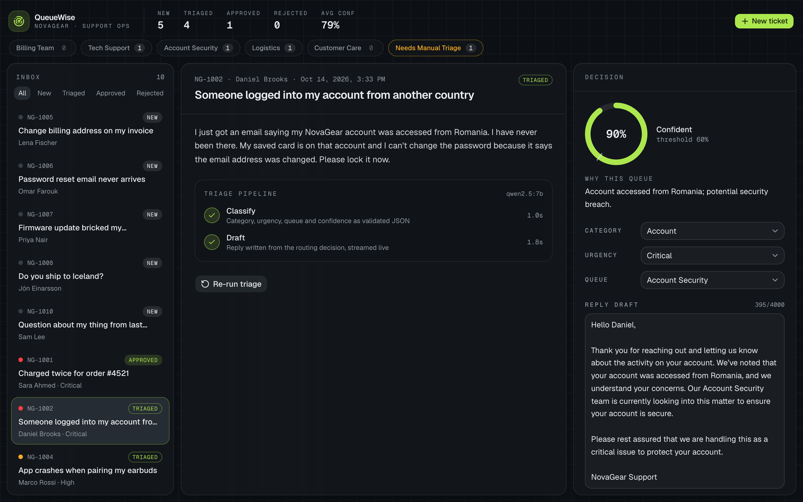
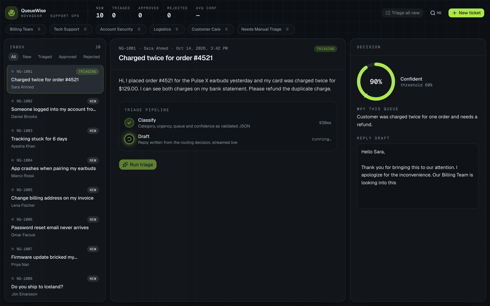
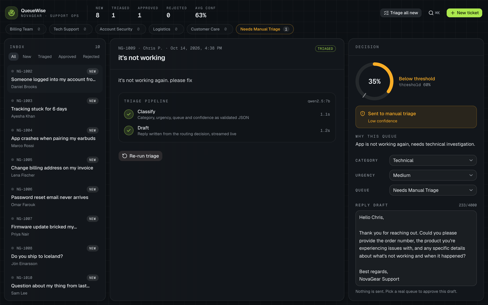
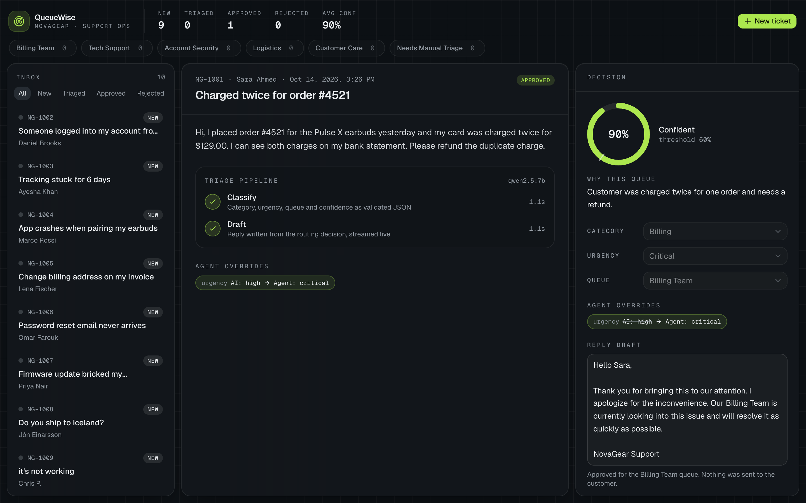

# QueueWise — Support Ticket Triage Copilot

QueueWise is a support console for **NovaGear**, a fictional electronics brand. A local LLM classifies each synthetic ticket by **category** and **urgency**, picks a **queue** from a fixed list, explains why, gives a **confidence** score, and drafts a reply. A human agent can change any field, edit the draft, then **approve** or **reject**. Nothing is ever sent.

Portfolio app 6 of 10. Scope: classify sample tickets, explain the suggested queue, draft a reply for human approval. Fixed queues, no live helpdesk.



## What it does

- **Two-step LangChain pipeline.** *Classify* returns JSON constrained by a JSON schema and validated by Pydantic (one repair retry). *Draft* streams the reply token by token.
- **Routing policy in code, not in the prompt.** Confidence below 0.6, a queue that does not serve the category, or instruction-like text caught by the injection detector sends the ticket to `Needs Manual Triage` with a flag. The draft then only asks the customer for details. The model also answers `concrete_issue` (does the ticket state an actionable problem?) just before scoring confidence; this steadies confidence on vague tickets but is not a routing rule.
- **Live pipeline over SSE.** Both steps animate in the UI with their timings.
- **Human in control.** Category, urgency and queue are editable; Approve is blocked until the route is valid. Every change against the AI suggestion shows as an audit chip.
- **Triage all new.** One click walks every new ticket through the pipeline with a progress bar. **Stop** ends the run at any time, and it stops by itself if the model or API goes offline. You can keep browsing other tickets while it runs.
- **Keyboard first.** Shortcuts for navigation, triage and review, plus a command palette to jump to any ticket or filter by queue.
- **Prompt-injection safeguards.** Ticket text is fenced as data in the prompt, and a code-level detector flags instruction-like text (override phrases, fake system turns, commands that set triage fields, output-format demands) and forces manual triage. Neither is a guarantee.

| Live triage | Manual triage | Approved with overrides |
| --- | --- | --- |
|  |  |  |

## Architecture

```text
Next.js UI (3005) ──HTTP/SSE──▶ FastAPI (8005) ──▶ LangChain ──▶ Ollama qwen2.5:7b (host :11434)
                                     │
                                     ▼
                              SQLite (queuewise.db)
```

The browser talks only to FastAPI. API types are generated from FastAPI's OpenAPI schema with `openapi-typescript`.

## Tech stack

| Layer | Choice |
| --- | --- |
| Frontend | Next.js 16 (App Router), React 19, TypeScript, Tailwind CSS v4, shadcn/ui (Radix), TanStack Query, zod + react-hook-form, motion, sonner |
| Backend | Python 3.12, FastAPI, Pydantic v2, pydantic-settings, sqlite3 |
| AI | LangChain (`langchain-core`, `langchain-ollama`), Ollama `qwen2.5:7b` (local, no cloud keys) |
| Tests | pytest with LangChain fake chat models, Vitest |
| Delivery | Docker Compose |

## Fixed taxonomy

| Field | Values |
| --- | --- |
| Category | billing, technical, account, shipping, general |
| Urgency | low, medium, high, critical |
| Queue | Billing Team, Tech Support, Account Security, Logistics, Customer Care, *Needs Manual Triage* (policy only) |

## API

| Method | Path | Purpose |
| --- | --- | --- |
| GET | `/health` | Ollama reachable, model pulled |
| GET | `/taxonomy` | Enums, category → queue matrix, threshold |
| GET | `/tickets?status=&queue=` | Inbox |
| GET | `/tickets/{id}` | One ticket with its triage |
| POST | `/tickets` | Create a ticket |
| POST | `/tickets/{id}/triage` | Run the pipeline (SSE: `step`, `classified`, `draft_token`, `done`, `error`) |
| POST | `/tickets/{id}/review` | Approve or reject with final values |
| GET | `/stats` | KPIs and open counts per queue |

## Run

Prerequisite: [Ollama](https://ollama.com) running on the host.

```bash
ollama serve
ollama pull qwen2.5:7b
```

### Docker

```bash
docker compose up --build
```

UI http://localhost:3005 · API http://localhost:8005/docs

Optional: `cp .env.example .env` to change ports or the model, then `docker compose up --build`.

Reset demo data: `docker compose down -v`

**Linux:** the backend container reaches Ollama through the Docker bridge gateway, but a default Ollama install listens only on 127.0.0.1. Start it with `OLLAMA_HOST=0.0.0.0 ollama serve`, or for the systemd service run `sudo systemctl edit ollama` and add:

```ini
[Service]
Environment="OLLAMA_HOST=0.0.0.0"
```

Then `sudo systemctl restart ollama`. Your firewall must also allow traffic from the Docker bridge to port 11434. Note that `OLLAMA_HOST=0.0.0.0` exposes the unauthenticated Ollama API on every interface; prefer binding to the Docker bridge IP instead (for example `OLLAMA_HOST=172.17.0.1`), or firewall port 11434 from other networks.

### Local

Prerequisites: Python 3.12, Node 22 and Ollama.

```bash
# backend
cd backend
python3.12 -m venv .venv && source .venv/bin/activate
pip install -r requirements-dev.txt
cp .env.example .env
uvicorn app.main:app --reload --port 8005

# frontend (second terminal)
cd frontend
npm install
cp .env.example .env.local
npm run dev
```

### Try it

- Triage NG-1001: a clear billing case, classified with high confidence.
- Triage NG-1009: a vague ticket that goes to `Needs Manual Triage`; the draft asks the customer for details.
- Change a field (for example urgency) and approve to see the audit chips.
- Create a ticket with "Triage immediately" checked.
- Click **Triage all new** to run every new ticket in turn; click **Stop** to end the run early.

#### Keyboard

| Key | Action |
| --- | --- |
| `J` / `K` | Next / previous ticket |
| `T` | Run triage on the selected ticket |
| `A` | Approve draft |
| `R` | Reject |
| `⌘K` (macOS) / `Ctrl K` | Command palette: jump to a ticket, filter a queue, run an action |

Letter shortcuts are ignored while typing in a field or when a dialog is open.

## Tests

```bash
cd backend && .venv/bin/pytest -q    # 184 passed
cd frontend && npm test              # 85 passed
```

Normal case: a double-charge ticket is classified `billing` / `high` / `Billing Team` and the draft streams and saves.
Failure cases: low confidence, queue that does not fit the category, instruction-like text in the subject or body, broken model JSON (repair then fallback), Chinese/Japanese/Korean text in the reason (repair, then manual-triage fallback), model picking the manual queue, empty or oversized tickets, Ollama down (503), draft failing mid-stream, approving twice (409), approving into manual triage or a wrong queue (422).

## Evaluation

`backend/scripts/eval_triage.py` classifies the 10 seed tickets and three sets of 12 held-out tickets with the live model, applies the same policy and injection check as the API, and scores category, urgency and queue against expected labels (`cd backend && .venv/bin/python -m scripts.eval_triage --out ../docs/eval-results.md`).

**Honest blind number** — held-out v3, written blind after the last prompt/policy change and run once (`qwen2.5:7b`, median classify 1461 ms):

- Held-out v3: Category 10/10 · Urgency 7/10 · Queue 11/12

The v3 misses are three urgencies rated one level too low (two `critical` tickets rated `high`, one `high` rated `medium`) and one simple billing change sent to Customer Care instead of Billing Team. Its prompt-injection ticket was not caught by the regex detector, but the model labelled the real request correctly.

Other sets in the same run:

- Seed tickets (used while tuning the prompt): Category 8/8 · Urgency 7/8 · Queue 9/10
- Held-out v1 (used to diagnose the fixes): Category 9/10 · Urgency 8/10 · Queue 11/12
- Held-out v2 (written blind, but now run twice; see below): Category 8/10 · Urgency 9/10 · Queue 10/12

History: before the safeguards the seed queue score was 9/10 and held-out v1 9/12, with the v1 injection obeyed and both vague v1 tickets routed. The first run with the safeguards also routed on `concrete_issue` and scored seed 8/10, v1 7/12 and blind v2 6/12, because that rule alone sent 9 answerable tickets to manual triage. The rule was dropped after seeing that v2 run (the field is kept as a reasoning step), so v2 is no longer fully blind, which is why v3 was written. All eight vague tickets across the held-out and seed sets now land in manual triage through low confidence. Full tables in [docs/eval-results.md](docs/eval-results.md).

## Known limitations

- 7B local model: labels and drafts vary between runs, and a draft can still slip past a prompt rule (for example implying a refund). The human review step is the safeguard.
- Confidence is the model's self-reported score, steered by a rubric and examples in the prompt. It is not a calibrated probability.
- Model-reported signals can be wrong: routing on `concrete_issue` sent many clear, simple questions to manual triage, so it is only used as a reasoning step.
- The injection detector is a set of regular expressions. A paraphrased attack can get past it (the injection tickets in both blind held-out sets did; the model happened to label them correctly anyway), and unusual but honest wording can trip it (it only ever sends a ticket to manual triage).
- Single agent, no authentication.
- The draft is not regenerated after the agent changes the classification.
- SQLite file storage, no multi-user concurrency.
- Drafts are never sent; there is no helpdesk or email integration.
- Docker reaches Ollama on the host via host.docker.internal; the model is not containerised.
- Python dependencies use minimum versions (`>=`), not a lock file, so Docker builds can pick up newer releases.

## References

- [LangChain Ollama integration](https://docs.langchain.com/oss/python/integrations/chat/ollama)
- [Ollama structured outputs](https://ollama.com/blog/structured-outputs)
- [shadcn/ui](https://ui.shadcn.com) components (copied into `frontend/src/components/ui`)
- Built with Cursor; all code reviewed, run and tested locally.
